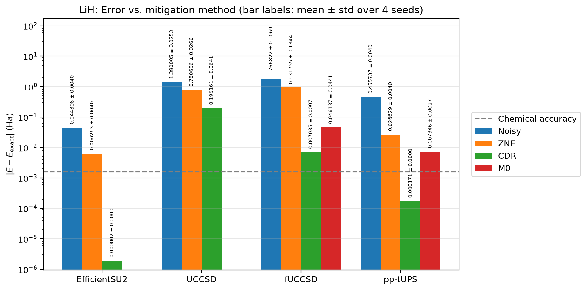

# QEM Chem Benchmark

A benchmark of quantum error mitigation (QEM) techniques for quantum-chemistry calculations on noisy hardware.

For a small molecule (H₂, LiH, HF), the project:

1. finds the ground-state energy with a noiseless VQE for several ansätze (EfficientSU2, UCCSD, fUCCSD, pp-tUPS) and several random seeds,
2. evaluates the optimised circuit on a noisy simulated IBM backend (`FakeTorino`),
3. applies error mitigation and measures how much of the error is removed:
   - **ZNE**: zero-noise extrapolation (circuit folding and fits from Mitiq), with linear, polynomial and exponential fits,
   - **CDR**: Clifford data regression (own implementation in `src/mitigation.py`),
   - **M0**: the SlowQuant mitigation (fUCCSD and pp-tUPS only),
4. saves the raw data, plots and a text log of every run.

Molecules, ansätze, backend and mitigation settings are all set in YAML files under `configs/`. The same steps are available as a script (`scripts/run_benchmark.py`, for long runs) and as notebooks (`notebooks/`, for step-by-step work).

This repository is part (work package 1) of my Master's thesis.

## Project layout

```
configs/      YAML settings, one file per molecule (h2.yaml, lih.yaml, hf.yaml)
src/          chem.py (molecules, ansätze), backend.py (noisy backend, VQE),
              mitigation.py (ZNE, CDR, M0), utils.py (config loading)
scripts/      run_benchmark.py: the full benchmark, driven by a config
notebooks/    01_H2_benchmark.ipynb, 02_LiH_benchmark.ipynb
data/         raw results (.npz)             -> data/latest/<molecule>/
plots/        figures (.png)                 -> plots/latest/<molecule>/
outputs/      text logs from the script      -> outputs/latest/<molecule>/
SlowQuant/    SlowQuant (installed from source, see below)
```

## Installation

**Requirements:** Python 3.11 or 3.12 (Mitiq does not support 3.13+ yet).

1. Clone the repository:

   ```bash
   git clone https://github.com/toukir26251/qem-chem-benchmark.git
   cd qem-chem-benchmark
   ```

2. Create and activate a virtual environment:

   ```bash
   python3.11 -m venv env
   source env/bin/activate
   ```

3. Install the dependencies:

   ```bash
   pip install --upgrade pip
   pip install -r requirements.txt
   ```

4. Install SlowQuant (used for fUCCSD, pp-tUPS and M0). It is not on PyPI, so install it from source:

   ```bash
   git clone https://github.com/erikkjellgren/SlowQuant.git
   cd SlowQuant
   pip install -e .
   cd ..
   ```

5. *(Optional, for JupyterLab users)* Register the environment as a Jupyter kernel:

   ```bash
   python -m ipykernel install --user --name qem-chem-benchmark
   ```

   Then select the `qem-chem-benchmark` kernel when opening the notebooks.

6. Check that everything works:

   ```bash
   python -c "import qiskit, mitiq, pyscf, slowquant; print('All set')"
   ```

## How to run

Activate the environment first (`source env/bin/activate`) and run everything from the repository root.

### Option 1: Script

```bash
python scripts/run_benchmark.py configs/h2.yaml
python scripts/run_benchmark.py configs/lih.yaml
```

Runs can take a long time (LiH and HF especially). To run in the background and keep going after you close the terminal:

```bash
nohup python scripts/run_benchmark.py configs/lih.yaml &
tail -f outputs/latest/LiH/LiH_<date>.log     # follow the progress
```

The script runs these steps in order:

1. HF and FCI reference energies.
2. Noiseless VQE for every ansatz and seed, then transpiling to the backend.
3. One noisy energy per ansatz and seed. ZNE (λ = 1), CDR and M0 all compare against this value.
4. The mitigation methods listed in the config (see below): ZNE, CDR, M0.
5. A summary table and a bar chart comparing the errors of all methods that ran.

**Choosing what to run.** The script runs exactly the methods that are listed under `mitigation:` in the config (`zne`, `cdr`, `m0`). To skip one, remove it or comment out its whole block. For example, with only `cdr:` left, only CDR runs, and the summary and the comparison chart show Noisy and CDR.

**Choosing the ZNE fit.** Under `mitigation: zne: method:` you can set `linear`, `poly` or `exp` for each ansatz. An ansatz with a value uses that fit. If the block or the entry is missing or empty, the fit with R² closest to 1 is chosen for each seed. Any other value raises an error.

### Option 2: Notebooks

Start JupyterLab (or open the notebooks in VS Code), select the `qem-chem-benchmark` kernel and run the cells from top to bottom:

```bash
jupyter lab
```

- `notebooks/01_H2_benchmark.ipynb`: H₂
- `notebooks/02_LiH_benchmark.ipynb`: LiH

The notebooks follow the same steps as the script. Two differences: they always run ZNE, CDR and M0 (the `mitigation:` selection is not used), and they always pick the ZNE fit by R² (the `method:` setting is not used). The first code cell sets the output folders (see below). The training step for CDR is slow; a markdown cell shows how to load saved training data instead.

## Example benchmarking

Comparison of the absolute energy error of Noisy, ZNE, CDR and M0 for LiH:



## Want to benchmark another molecule or system?

You do not need to change any code. A new system is just a new config file.

1. **Copy a config.** Start from the one closest to your system:

   ```bash
   cp configs/lih.yaml configs/mysystem.yaml
   ```

2. **Edit the `molecule:` block.** For example, for BeH₂ (illustrative values, not a tested setup):

   ```yaml
   molecule:
     name: BeH2                              # decides every folder and file name, so give it a unique name
     geometry: "Be 0 0 0; H 0 0 1.33; H 0 0 -1.33"   # Angstrom
     basis: sto-3g
     charge: 0
     spin: 0                                 # number of unpaired electrons (2S)
     active_space:
       n_electrons: 4
       n_orbitals: 4
   ```

3. **Pick what to run.** Under `mitigation:` keep only the methods you want (`zne`, `cdr`, `m0`), and optionally fix the ZNE fit per ansatz. Change `vqe.seeds` and `ansatze` if needed.

4. **Run it:**

   ```bash
   python scripts/run_benchmark.py configs/mysystem.yaml
   ```

   Results appear in `data/latest/BeH2/`, `plots/latest/BeH2/` and `outputs/latest/BeH2/`. Other molecules' results are not touched.

Things to check before a long run:

- **Active space.** The circuit has 2 × `n_orbitals` qubits. The noisy simulation is a density-matrix simulation and CDR runs many training circuits, so the cost grows quickly. For a first try keep the active space small and lower `mitigation.cdr.max_circuits`.
- **Name.** Two configs with the same `molecule.name` write to the same folders, and the second run moves the first one to `backup/`.
- **Spin and charge.** They must match the electron count and `active_space.n_electrons`, or PySCF will fail.
- **Notebooks.** The notebooks load a fixed config (`configs/h2.yaml` or `configs/lih.yaml`) and a fixed `MOL` in their first cells. To use another system there, copy a notebook and change the config path and `MOL` in the first cells, and the molecule name in the plot titles and file names.
- **M0.** It only supports fUCCSD and pp-tUPS, so other ansätze are skipped for it.

## Where the results go

Each molecule has its own folders, and each run replaces the previous one:

| Output | Current run | Previous run |
| --- | --- | --- |
| Raw results (`.npz`) | `data/latest/<molecule>/` | `data/backup/<molecule>/<timestamp>/` |
| Plots (`.png`) | `plots/latest/<molecule>/` | `plots/backup/<molecule>/<timestamp>/` |
| Text log (script only) | `outputs/latest/<molecule>/` | `outputs/backup/<molecule>/<timestamp>/` |

- At the start of a run, whatever is in `latest/<molecule>/` is moved to `backup/<molecule>/<timestamp>/` (for example `2026-11-19_142240`). A run of one molecule never touches another molecule's folders.
- This happens on every run, including a run that only uses some of the mitigation methods. Files you want to keep next to the new results must be copied back from `backup/`.
- In the notebooks the move happens when the first code cell is run, so re-running that cell mid-session moves the results produced so far.
- File names: `<molecule>_<ansatz>_ZNE_seed<seed>_<date>.npz`, `<molecule>_<ansatz>_CDR_seed<seed>_<date>.npz`, and plots such as `<molecule>_ZNE_errors_<date>.png`, `<molecule>_CDR_errors_<date>.png`, `<molecule>_M0_errors_<date>.png` and `<molecule>_mitigation_errors_<date>.png`.

`*.npz` files and `outputs/*` are not tracked by git.

### Reading the error plots

The bar charts show the absolute energy error |E − E_exact| (Ha) on a **log axis**, with the chemical-accuracy line at 1.6 × 10⁻³ Ha. There are no error bars. Each bar is labelled `mean ± std`, where mean and standard deviation (`np.std`, ddof = 0) are taken over the seeds. With the log axis, a symmetric ± std can reach below zero, so the numbers in the labels are the exact spread.

## Changing the settings

Edit a YAML file in `configs/`:

| Section | What it sets |
| --- | --- |
| `molecule` | name, geometry (Å), basis, charge, spin, active space (`n_electrons`, `n_orbitals`) |
| `ansatze` | per-ansatz options, such as `reps` and `entanglement` for EfficientSU2, `n_layers` for pp-tUPS |
| `vqe` | optimizer, `maxiter`, and `seeds` (every ansatz is run once per seed) |
| `backend` | `FakeTorino`, transpiler `optimization_level`, `mode: precision` or `shots` with `precision` / `shots`, and the simulator `method` |
| `mitigation.zne` | `noise_factors`, `folding` (`global` or `random`), `poly_order`, optional per-ansatz `method` |
| `mitigation.cdr` | `k` (non-Clifford gates kept per training circuit), `clifford_tol`, `max_circuits`, `sampling`, `fit` |
| `mitigation.m0` | `shots`, `postselection` |

To add a new molecule or system, see [Want to benchmark another molecule or system?](#want-to-benchmark-another-molecule-or-system) above.

## Notes

- M0 only works with the SlowQuant ansätze (fUCCSD and pp-tUPS). For the other ansätze its entry is empty in the summary.
- The backend is a noisy simulation (`FakeTorino`), not a real device, so no IBM account is needed.
- The seed is passed to the transpiler and the noisy simulator (and to the sampling of CDR training circuits). The VQE starting point does not depend on it: EfficientSU2 uses a fixed random start and the other ansätze start from zero. The seeds therefore measure the spread from transpiling and noisy sampling.
